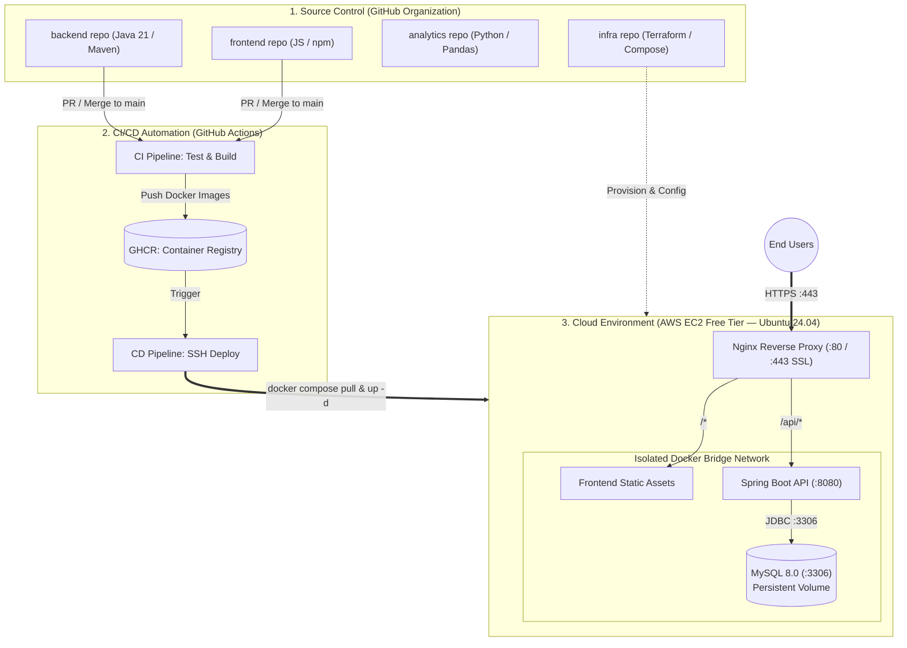

# 🏗️ Team 262 — Cloud Infrastructure & DevOps Architecture

This repository contains Infrastructure as Code (IaC), container configurations, deployment scripts, and architecture documentation for the **Team 262** project.

---

## 📐 End-to-End System & CI/CD Architecture

---

## 📁 Repository Structure

* **`terraform/`** — Terraform plans for provisioning cloud resources (AWS EC2, Security Groups, VPC).
* **`compose/`** — Production Docker Compose files and Nginx reverse-proxy configurations.
* **`manifests/`** — Kubernetes deployment and service manifests for portfolio and cloud-native scaling.
* **`scripts/`** — Automation scripts for database backups and server maintenance.

---

## 🔐 Security by Default Principles

1. **Zero Hardcoded Secrets:** Database passwords, API tokens, and SSH keys are never stored in Git. Local environments use `.env` (via `.env.example` templates), while CI/CD pipelines inject secrets via **GitHub Actions Secrets** (`${{ secrets.* }}`) and AWS Parameter Store.
2. **Branch Protection & Git Flow:** Direct pushes to `main` and `develop` are blocked across all repositories. All changes require a Pull Request and Squash Merge.
3. **Network Isolation:** In production, the MySQL 8.0 database runs inside an isolated Docker bridge network without public port exposure (`3306` is accessible only to the `backend` service).

---

## 💾 Backup & Disaster Recovery Plan

* **RPO (Recovery Point Objective):** `< 24 hours` — automated daily logical backups of the MySQL database via `mysqldump` cron job with 7-day retention.
* **RTO (Recovery Time Objective):** `< 15 minutes` — full infrastructure and application recovery via Terraform state and Docker Compose deployment from GitHub Container Registry.