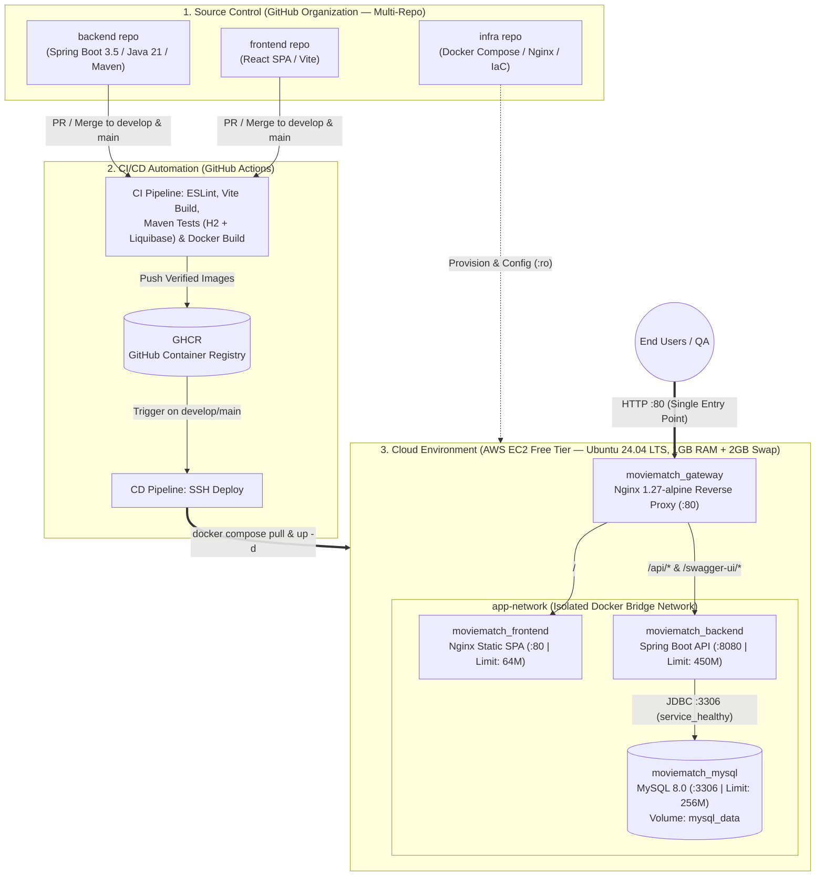

# 🏗️ Movie Match (Team 262) — Cloud Infrastructure & DevOps Architecture

This repository (`infra`) contains the centralized Infrastructure as Code (IaC), production-ready Docker Compose orchestration, Nginx API Gateway configurations, environment templates, and deployment automation for the **Movie Match** project (**Team 262**).

---

## 📐 End-to-End System & CI/CD Architecture



---

## 🧩 Multi-Repository Ecosystem

The project follows a decoupled **Multi-Repo** architecture with strict branch protection rules (`develop` $\rightarrow$ `main`):

| Repository | Tech Stack | Role & Build Artifact |
| :--- | :--- | :--- |
| **`frontend`** | React (SPA), Vite, ESLint, Nginx | Multi-stage Docker build compiling static assets served via an internal Nginx container. |
| **`backend`** | Java 21 JRE, Spring Boot 3.5, Maven, Liquibase, H2 / MySQL | Multi-stage Docker build packaging the REST API JAR; CI validates Liquibase migrations against in-memory H2. |
| **`infra`** | Docker Compose, Nginx 1.27, Bash, Terraform | Centralized orchestration, reverse-proxy routing, security hardening, and cloud provisioning. |

---

## ⚙️ Production Stack & Memory Optimization (AWS Free Tier)

To run reliably on an **AWS EC2 Free Tier** instance (`t2.micro` / `t3.micro` with **1 GB RAM** on Ubuntu 24.04 LTS) without triggering the Linux **OOM (Out-Of-Memory) Killer**, every container in `compose/docker-compose.yml` is governed by strict resource limits (`deploy.resources.limits.memory`):

| Container Name | Image / Stack | Internal Port | Host Port | Memory Limit | Key Engineering Decisions |
| :--- | :--- | :---: | :---: | :---: | :--- |
| **`moviematch_gateway`** | `nginx:1.27-alpine` | `80` | `80` | `64M` *(shared/light)* | Single entry point; mounts `nginx.conf` in **read-only (`:ro`)** mode. |
| **`moviematch_frontend`** | Custom React + Nginx | `80` | *None* | **`64M`** | Serves static Vite bundle inside `app-network`. |
| **`moviematch_backend`** | Spring Boot 3.5 (Java 21) | `8080` | *None* | **`450M`** | Waits for DB readiness via `depends_on` (`condition: service_healthy`). |
| **`moviematch_mysql`** | `mysql:8.0` | `3306` | *None* | **`256M`** | Tuned with `--performance_schema=OFF` and `--innodb_buffer_pool_size=64M` (reduces idle RAM from ~500 MB to ~160 MB). Persistent storage via `mysql_data` volume. |

> **Host-Level Protection:** In addition to container hard limits (~770 MB total ceiling), the target EC2 host is configured with a mandatory **2 GB Swap file** to absorb JVM startup spikes during deployments.

---

## 🌐 API Gateway & Routing Architecture (CORS Elimination)

All external HTTP traffic enters exclusively through port `80` of **`moviematch_gateway`**. Because the browser interacts with both the React SPA and the Spring Boot API through the exact same domain and port (**Same-Origin Policy**), cross-origin resource sharing (**CORS**) issues are eliminated at the infrastructure layer.

| Request Path | Target Upstream | Purpose |
| :--- | :--- | :--- |
| `/` | `http://moviematch_frontend:80` | Serves the React Single Page Application (SPA). |
| `/api/*` | `http://moviematch_backend:8080` | Proxies REST API requests to the Spring Boot backend. |
| `/swagger-ui/index.html` | `http://moviematch_backend:8080` | Exposes interactive OpenAPI / Swagger UI documentation. |
| `/v3/api-docs` | `http://moviematch_backend:8080` | Serves raw OpenAPI 3.0 JSON specification for Swagger UI. |
| `/gateway-health` | `moviematch_gateway` (internal) | Returns `200 OK` directly from Nginx for lightweight uptime checks. |

---

## 📁 Repository Structure

```text
infra/
├── compose/
│   ├── docker-compose.yml       # Production-ready 4-container orchestration stack
│   ├── .env.example             # Safe template for environment variables (committed to Git)
│   └── nginx/
│       └── nginx.conf           # Reverse-proxy routing & security headers (:ro mount)
├── terraform/                   # IaC plans for AWS EC2, Security Groups, and networking
├── scripts/                     # Server bootstrap (Swap, Docker) and DB backup scripts
└── README.md                    # Architecture & operational documentation
```

---

## 🚀 Full-Cycle Deployment & Verification Guide

### 1. Environment Preparation
Clone the repository, switch to the `develop` branch, and initialize the environment variables file from the template:

```bash
git clone https://github.com/mate-team-project-262/infra.git
cd infra/compose
cp .env.example .env
```
*Edit `.env` with secure production credentials (`MYSQL_ROOT_PASSWORD`, `MYSQL_DATABASE`, `MYSQL_USER`, `MYSQL_PASSWORD`, etc.).*

### 2. Stack Deployment
Start the stack in detached mode:

```bash
docker compose up -d
```

### 3. Post-Deployment Verification & Diagnostics
Verify that all 4 containers are running and that health checks pass:

```bash
# 1. Check container status, health state, and port bindings
docker compose ps

# 2. Monitor real-time resource consumption (verify RAM limits)
docker stats --no-stream

# 3. Verify Nginx Gateway health endpoint
curl -i http://localhost/gateway-health

# 4. Verify Frontend SPA delivery
curl -I http://localhost/

# 5. Verify Backend Swagger OpenAPI spec routing through Gateway
curl -s http://localhost/v3/api-docs | head -c 200

# 6. Inspect container logs if troubleshooting is required
docker compose logs -f moviematch_backend
```

---

## 🔐 Security by Default Principles

1. **Zero Hardcoded Secrets:** Database passwords, API tokens, and SSH keys are strictly excluded from Git via `.gitignore`. Local and EC2 environments inject variables from `.env` (initialized from `.env.example`), while CI/CD pipelines utilize encrypted **GitHub Actions Secrets** (`${{ secrets.* }}`).
2. **Network Isolation:** Only `moviematch_gateway` binds to host port `80`. Both `moviematch_backend` (`8080`) and `moviematch_mysql` (`3306`) operate exclusively inside the internal `app-network` bridge without public port bindings.
3. **Immutable Configuration Mounts:** Gateway configuration (`nginx.conf`) is mounted into the container with the `:ro` (**read-only**) flag, preventing runtime tampering inside the container.
4. **Branch Protection & Quality Gates:** Direct pushes to `develop` and `main` are blocked. Merging requires Pull Request approval and passing **Required Status Checks** (ESLint, Vite compilation, Maven unit/integration tests with Liquibase on H2, and Docker build verification).

---

## 💾 Backup & Disaster Recovery Plan

- **RPO (Recovery Point Objective):** `< 24 hours` — automated daily logical backups of the `moviematch_mysql` database via a scheduled `mysqldump` cron job with a 7-day retention policy.
- **RTO (Recovery Time Objective):** `< 15 minutes` — rapid infrastructure provisioning and stack recovery using Docker Compose and pre-built images from **GitHub Container Registry (GHCR)**.