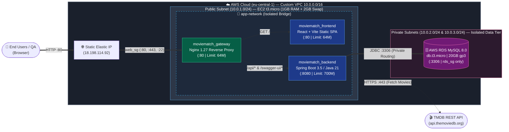
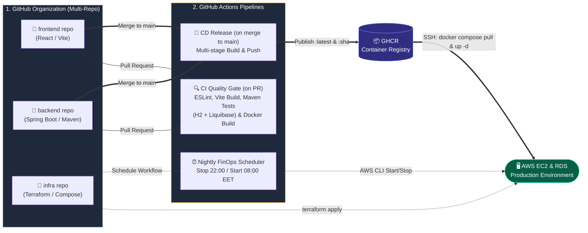

# 🏗️ Movie Match (Team 262) — Cloud Infrastructure & DevOps Architecture

This repository (`infra`) contains the centralized Infrastructure as Code (IaC), multi-environment Docker Compose orchestration, Nginx API Gateway configuration, environment templates, and deployment automation for the **Movie Match** project (**Team 262**).

---

## 📐 System Architecture & Cloud Network Topology

### 1. Runtime & AWS VPC Network Architecture
Traffic enters exclusively through the static **Elastic IP** (`:80` / `:443`) into the public subnet, while the **AWS RDS MySQL 8.0** database remains isolated inside private subnets without public internet access:



### 2. Multi-Repo CI/CD & IaC Automation Flow



---

## 🧩 Multi-Repository Ecosystem

The project follows a decoupled **Multi-Repo** architecture with strict branch protection rules (`develop` $\rightarrow$ `main`):

| Repository | Tech Stack | Role & Build Artifact |
| :--- | :--- | :--- |
| **`frontend`** | React (SPA), Vite, ESLint, Nginx | Multi-stage Docker build compiling static assets served via an internal Nginx container. |
| **`backend`** | Java 21 JRE, Spring Boot 3.5, Maven, Liquibase, H2 / MySQL | Multi-stage Docker build packaging the REST API JAR; CI validates Liquibase migrations against in-memory H2. |
| **`infra`** | Terraform, Docker Compose, Nginx 1.27, Bash, GitHub Actions | Cloud network/compute/RDS provisioning (AWS), reverse-proxy routing, security hardening, and stack orchestration. |

---

## ☁️ Cloud Infrastructure & IaC Architecture (Terraform)

Cloud resources are provisioned in the `eu-central-1` (Frankfurt) region using **Terraform** (`>= 1.6.0`, AWS Provider `~> 5.0`):

- **Networking (Multi-Tier VPC):** Isolated custom **VPC** (`10.0.0.0/16`) with 1 **Public Subnet** (`10.0.1.0/24`, Internet Gateway, Route Table) for the application server and 2 **Private Subnets** (`10.0.2.0/24`, `10.0.3.0/24` across two Availability Zones) for the database tier.
- **Decoupled Static Addressing:** Dedicated **AWS Elastic IP (EIP)** bound via `aws_eip_association` so the public IPv4 address (`18.198.114.92`) remains persistent even if the EC2 instance is recreated.
- **Stateful Firewalls (Security Groups):**
  - `web_sg` (EC2): Restricts inbound traffic strictly to ports `22` (SSH), `80` (HTTP), and `443` (HTTPS).
  - `rds_sg` (RDS): Restricts inbound MySQL traffic (`3306`) exclusively to instances attached to `web_sg` (Security Group referencing).
- **Compute & Storage Optimization:** `t3.micro` instance running official Canonical **Ubuntu 22.04 LTS (Jammy)** with an encrypted **20 GB `gp3` EBS root volume** (leaving 10 GB of the 30 GB AWS Free Tier limit reserved for a dedicated Monitoring VM).
- **Managed Database Tier (AWS RDS):** Single-AZ **MySQL 8.0** (`db.t3.micro`) instance with 20 GB encrypted `gp3` storage (`max_allocated_storage = 20`), custom `aws_db_parameter_group` enforcing `utf8mb4` / `utf8mb4_unicode_ci`, and automated daily snapshots (`backup_retention_period = 1`).
- **Instance Security (IMDSv2):** Enforces session-oriented Instance Metadata Service v2 (`http_tokens = "required"`, `hop_limit = 2` for containerized environments).
- **Automated Host Bootstrapping (`cloud-init`):** Injects `scripts/bootstrap.sh` on first boot to configure a **2 GB Swap file** (`vm.swappiness=10`), install **Docker Engine, Compose plugin, and MySQL client**, and enforce JSON log rotation (`max-size: 10m`, `max-file: 3`).

---

## ⚙️ Container Stack & Memory Optimization (AWS Free Tier)

Because the MySQL database is offloaded to **AWS RDS** in production, the **1 GB RAM** (`t3.micro`) EC2 host dedicates the majority of its physical memory directly to the Spring Boot JVM while retaining a local MySQL container under the `local` Compose profile for offline developer and QA testing:

| Container Name | Image / Stack | Compose Profile | Internal Port | Host Port | RAM Limit | Key Engineering Decisions |
| :--- | :--- | :---: | :---: | :---: | :---: | :--- |
| **`moviematch_gateway`** | `nginx:1.27-alpine` | *Default (All)* | `80` | `80` | **`64M`** | Single entry point; mounts `nginx.conf` in **read-only (`:ro`)** mode. |
| **`moviematch_frontend`** | Custom React + Nginx | *Default (All)* | `80` | *None* | **`64M`** | Serves static Vite bundle inside `app-network`. |
| **`moviematch_backend`** | Spring Boot 3.5 (Java 21) | *Default (All)* | `8080` | *None* | **`700M`** | Connects to AWS RDS in production (or local MySQL when `COMPOSE_PROFILES=local`). |
| **`moviematch_mysql`** | `mysql:8.0` | `local` *(Dev/QA)* | `3306` | `127.0.0.1:3306` | **`256M`** | Tuned with `--performance_schema=OFF` & `--innodb_buffer_pool_size=64M` for local testing. Disabled on AWS EC2. |

> **Host-Level Protection:** In addition to container hard limits (~828 MB total ceiling on EC2), the target EC2 host is configured with a mandatory **2 GB Swap file** via `scripts/bootstrap.sh` to absorb JVM startup spikes during deployments.

---

## 🌐 API Gateway & Routing Architecture (CORS Elimination)

All external HTTP traffic enters exclusively through port `80` of **`moviematch_gateway`**. Because the browser interacts with both the React SPA and the Spring Boot API through the exact same domain and port (**Same-Origin Policy**), cross-origin resource sharing (**CORS**) issues are eliminated at the infrastructure layer.

| Request Path | Target Upstream | Purpose |
| :--- | :--- | :--- |
| `/` | `http://moviematch_frontend:80` | Serves the React Single Page Application (SPA). |
| `/api/*` | `http://moviematch_backend:8080/` | Proxies REST API requests to Spring Boot (strips `/api` prefix, e.g. `/api/rooms` $\rightarrow$ `/rooms`). |
| `/swagger-ui/index.html` | `http://moviematch_backend:8080/swagger-ui/` | Exposes interactive OpenAPI / Swagger UI documentation. |
| `/v3/api-docs` | `http://moviematch_backend:8080/v3/api-docs` | Serves raw OpenAPI 3.0 JSON specification for Swagger UI. |
| `/gateway-health` | `moviematch_gateway` (internal) | Returns `200 OK` directly from Nginx for lightweight uptime checks. |

---

## 📁 Repository Structure

```text
infra/
├── compose/
│   ├── docker-compose.yml         # Multi-environment orchestration stack (AWS RDS + 'local' DB profile)
│   ├── .env.example               # Safe template for environment variables (committed to Git)
│   └── nginx/
│       └── nginx.conf             # Reverse-proxy routing & security headers (:ro mount)
├── terraform/                     # AWS Cloud Infrastructure as Code (IaC)
│   ├── main.tf                    # VPC, Public/Private Subnets, IGW, SGs, EIP, EC2, and RDS MySQL 8.0
│   ├── variables.tf               # Input variables (CIDRs, instance types, volume size, DB credentials)
│   ├── outputs.tf                 # Exported attributes (Elastic IP, RDS endpoint, SSH command)
│   ├── providers.tf               # AWS provider version constraints & default resource tags
│   └── .terraform.lock.hcl        # Cryptographic provider dependency lock file
├── scripts/
│   └── bootstrap.sh               # Cloud-init userdata script (2GB Swap, Docker, MySQL client, log rotation)
└── README.md                      # Architecture & operational documentation
```

---

## 🚀 Full-Cycle Deployment & Verification Guide

### Workflow A: Local Development & QA Testing (Offline Mode with Local MySQL)

Use this workflow to test the complete integrated stack on your workstation:

```bash
# 1. Build local images from 'frontend' and 'backend' repositories
cd ../frontend && docker build -t team262-frontend:local .
cd ../backend  && docker build -t team262-backend:local .

# 2. Prepare local environment variables in 'infra/compose'
cd ../infra/compose
cp .env.example .env
# Ensure .env contains: COMPOSE_PROFILES=local and MYSQL_HOST=mysql

# 3. Launch all 4 containers (gateway, frontend, backend, and local mysql)
docker compose up -d

# 4. Verify container health and logs
docker compose ps
docker compose logs -f backend
```
*Note: If you change `MYSQL_USER` or `MYSQL_PASSWORD` in `.env` after initial creation, reset the local database volume via `docker compose --profile local down -v` before starting again.*

---

### Workflow B: AWS Cloud Provisioning & Production Deployment (EC2 + RDS)

#### Step 1: Provision AWS Infrastructure via Terraform (Run on Local Workstation)
Ensure AWS CLI is configured (`aws configure`) and an Ed25519 SSH key pair exists at `~/.ssh/id_ed25519.pub`:

```bash
cd terraform

# 1. Export the sensitive RDS master password in your terminal session
export TF_VAR_mysql_password="YourStrongRdsPassword!" # PowerShell: $env:TF_VAR_mysql_password="..."

# 2. Initialize, validate, and apply the infrastructure plan
terraform init
terraform fmt -check
terraform validate
terraform plan -out=tfplan
terraform apply "tfplan"
rm -f tfplan

# 3. Retrieve provisioned endpoints
terraform output
```

#### Step 2: Configure & Launch Production Stack on AWS EC2
Connect to the EC2 instance using the `public_ip` output and configure `.env` to point to the `mysql_host` RDS endpoint:

```bash
# 1. Connect to EC2 via SSH
ssh -i ~/.ssh/id_ed25519 ubuntu@18.198.114.92

# 2. Verify cloud-init completion and test TCP connectivity to AWS RDS (:3306)
cloud-init status --wait
nc -zv <RDS_MYSQL_HOST_FROM_TERRAFORM_OUTPUT> 3306

# 3. Clone repository and configure production .env (without COMPOSE_PROFILES=local)
git clone https://github.com/mate-team-project-262/infra.git /home/ubuntu/infra
cd /home/ubuntu/infra/compose
cp .env.example .env
nano .env   # Remove COMPOSE_PROFILES=local, set MYSQL_HOST to RDS endpoint, set real passwords & TMDB_API_KEY
chmod 600 .env

# 4. Start the 3 production containers (gateway, frontend, backend)
docker compose up -d
```

#### Step 3: Post-Deployment Verification & Diagnostics
Run these checks to verify end-to-end routing:

```bash
# 1. Check container status, health state, and resource consumption
docker compose ps
docker stats --no-stream

# 2. Verify Nginx Gateway health endpoint (200 OK)
curl -i http://localhost/gateway-health

# 3. Verify Frontend SPA delivery
curl -I http://localhost/

# 4. Verify Backend API routing & Room creation (POST /api/rooms -> 201 Created)
curl -i -X POST http://localhost/api/rooms \
  -H "Content-Type: application/json" \
  -d '{"displayName": "DevOpsTest"}'

# 5. Verify Backend Swagger OpenAPI spec routing through Gateway
curl -s http://localhost/v3/api-docs | head -c 200
```

---

## 🔐 Security by Default Principles

1. **Zero Hardcoded Secrets & State Isolation:** Database passwords, API tokens, SSH keys, and Terraform state files (`*.tfstate`, `tfplan`) are strictly excluded from Git via `.gitignore`.
2. **Private Data Tier:** AWS RDS MySQL 8.0 operates in isolated private subnets (`publicly_accessible = false`) without a public IP address; port `3306` only accepts connections originating from the EC2 Security Group (`web_sg`).
3. **Least-Privilege Cloud Access:** Infrastructure is provisioned via dedicated IAM credentials with IMDSv2 enforced on compute instances.
4. **Immutable Configuration Mounts:** Gateway configuration (`nginx.conf`) is mounted into the container with the `:ro` (**read-only**) flag, preventing runtime tampering inside the container.
5. **Branch Protection & Quality Gates:** Direct pushes to `develop` and `main` are blocked. Merging requires Pull Request approval and passing **Required Status Checks**.

---

## 💾 Backup & Disaster Recovery Plan

- **RPO (Recovery Point Objective):** `< 24 hours` — guaranteed by **AWS RDS Automated Daily Backups** (`backup_retention_period = 1` with Point-in-Time Recovery in Free Tier) supplemented by scheduled logical `mysqldump` backups.
- **RTO (Recovery Time Objective):** `< 15 minutes` — rapid infrastructure provisioning via Terraform (`terraform apply`) and stack recovery using Docker Compose and pre-built images from **GitHub Container Registry (GHCR)**.