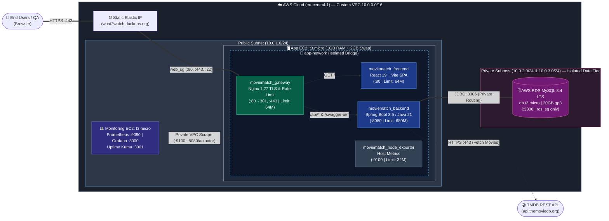

# Architecture, AWS Network Topology & Gateway Routing

This document describes the end-to-end request flow, AWS VPC infrastructure managed via Terraform, container memory allocation on `t3.micro` instances, and edge security enforced by the Nginx Gateway.

---

## 1. End-to-End Request Flow & AWS VPC Topology

In production, all client traffic enters through a single HTTPS origin (`https://what2watch.duckdns.org`) terminated at the **Nginx Edge Gateway**. Serving both the React SPA (`/`) and the Spring Boot REST API (`/api/*`) behind the same reverse proxy eliminates browser cross-origin issues in production, while explicit `FRONTEND_ORIGINS` CORS configuration supports local Vite development (`http://localhost:5173`).



### Room Lifecycle & Client-Server Synchronization
1. **Room Creation & Join (`POST /api/rooms`, `POST /api/rooms/{code}/join`):** Strictly rate-limited at the Nginx edge to prevent room exhaustion and brute-force code guessing.
2. **Lobby & Active Voting (`/api/rooms/{code}/*`):** Participants synchronize room state and deck progress via lightweight 3-second HTTP polling. To support concurrent players without false-positive throttling, Nginx separates general API polling into a high-throughput rate-limit zone (`api_general`) while keeping write operations in a strict zone (`api_room_write`).

---

## 2. Terraform IaC Resources (`terraform/`)

All cloud resources are declaratively provisioned in `terraform/main.tf`:

| Resource Type | Identifier / Name | Specification & Security Posture |
| :--- | :--- | :--- |
| **VPC & Subnets** | `team262-app-vpc` | `10.0.0.0/16` with DNS support; 1 Public Subnet (`10.0.1.0/24`) and 2 Private Subnets (`10.0.2.0/24`, `10.0.3.0/24`) across two Availability Zones. |
| **Primary App VM** | `team262-app-ec2` | Ubuntu 22.04 LTS (`t3.micro`), static Elastic IP (`team262-app-eip`), `20 GB` encrypted GP3 root volume, IMDSv2 enforced (`http_tokens = "required"`). |
| **Monitoring VM** | `team262-app-monitoring-ec2` | Ubuntu 22.04 LTS (`t3.micro`), `10 GB` encrypted GP3 volume. Combined with App EC2 (`20 GB + 10 GB = 30 GB`), stays strictly within the AWS Free Tier EBS limit. |
| **Database (RDS)** | `team262-app-db` | MySQL `8.4` LTS (`db.t3.micro`), `20 GB` encrypted GP3, Single-AZ, `publicly_accessible = false`. Enforces `utf8mb4` & `utf8mb4_unicode_ci` via `aws_db_parameter_group`. |
| **App Firewall** | `team262-app-sg` (`web_sg`) | **Public Ingress:** TCP `22` (SSH), `80` (HTTP), `443` (HTTPS).<br>**Internal VPC Ingress:** TCP `8080` (Actuator) and `9100` (Node Exporter) strictly from `monitoring_sg`. |
| **RDS Firewall** | `team262-app-rds-sg` | **Private Ingress:** TCP `3306` exclusively from `team262-app-sg` (App EC2). Zero public internet access. |
| **Monitoring Firewall** | `team262-app-monitoring-sg` | **Public Ingress:** TCP `22` (SSH), `3000` (Grafana UI), `3001` (Uptime Kuma UI). |

### Host Bootstrapping (`scripts/bootstrap.sh`)
Both EC2 instances execute `scripts/bootstrap.sh` via `user_data` during first boot:
1. Allocates a **2 GB Swap file** (`/swapfile`) with `vm.swappiness=10` to protect the JVM and Docker daemon from Linux OOM Killer spikes on `1 GB RAM` (`t3.micro`) hosts.
2. Installs official **Docker Engine & Docker Compose plugin**.
3. Configures `/etc/docker/daemon.json` with `json-file` log rotation (`max-size: 10m`, `max-file: 3`) to prevent disk space exhaustion.

---

## 3. Container Memory Budgets (`compose/docker-compose.yml`)

Every container enforces hard Docker memory limits calibrated for a `t3.micro` instance (`1024 MB` physical RAM + `2048 MB` swap):

| Container Name | Image | Profile | Port Mapping | Memory Limit | Runtime / JVM Optimization |
| :--- | :--- | :--- | :--- | :--- | :--- |
| `moviematch_gateway` | `nginx:1.27-alpine` | default (all) | `80:80`, `443:443` | **64 MB** | Read-only Let's Encrypt certificate mounts |
| `moviematch_frontend` | `team262-frontend` | default (all) | `80` (internal) | **64 MB** | Multi-stage static React/Vite build served by Nginx |
| `moviematch_backend` | `team262-backend` | default (all) | `8080:8080` | **680 MB** | `-XX:MaxRAMPercentage=70.0 -XX:+UseG1GC` |
| `moviematch_node_exporter`| `prom/node-exporter:v1.8.2`| default (all) | `9100:9100` | **32 MB** | Read-only host `/proc`, `/sys`, `/` mounts |
| `moviematch_mysql` | `mysql:8.0` | `local` only | `127.0.0.1:3306:3306`| **256 MB** | `--performance_schema=OFF --innodb_buffer_pool_size=64M` |

*Total Production App EC2 Footprint:* $64 + 64 + 680 + 32 = 840\text{ MB}$, leaving $\sim 184\text{ MB}$ of physical RAM plus $2\text{ GB}$ swap for the Linux kernel and system services.

---

## 4. Nginx Gateway Routing, SSL/TLS & Rate Limiting

The Edge Gateway loads `compose/nginx/nginx.conf` in production and `compose/nginx/nginx.local.conf` in local development (`COMPOSE_PROFILES=local`).

### SSL/TLS & Security Headers
* **TLS Termination:** Listens on `443 ssl` with `http2 on`, using Let's Encrypt certificates (`/etc/letsencrypt/live/what2watch.duckdns.org/`). Port `80` serves `/gateway-health` locally and redirects all other HTTP requests (`301`) to HTTPS.
* **Security Headers:** Enforces `Strict-Transport-Security` (HSTS, 1 year), `X-Frame-Options: SAMEORIGIN`, `X-Content-Type-Options: nosniff`, `Referrer-Policy: strict-origin-when-cross-origin`, `Permissions-Policy`, and a strict `Content-Security-Policy` permitting TMDB poster images (`https://image.tmdb.org`) and Google Analytics.

### Differentiated API Rate Limiting & QA Bypass
When a client exceeds rate limits, Nginx returns **HTTP `429 Too Many Requests`** (with `Retry-After: 10` and `Cache-Control: no-store`) formatted to match the Backend `ErrorResponse` JSON contract:
```json
{"code":"TOO_MANY_REQUESTS","message":"Rate limit exceeded. Please wait a moment and try again.","fieldErrors":[]}
```

| Zone Name | Target Endpoints | Production Limit (`nginx.conf`) | Local Limit (`nginx.local.conf`) | Key / Bypass Logic |
| :--- | :--- | :--- | :--- | :--- |
| `api_room_write` | `POST /api/rooms`<br>`POST /api/rooms/{code}/join` | `10 req/min` (`burst=5 nodelay`) | `120 req/min` (`burst=30 nodelay`) | Applies **only** to `POST` requests. `GET` requests and automated QA requests with `X-QA-Bypass: team262-qa` evaluate to `""` (bypassed). |
| `api_general` | `/api/*` (incl. 3s polling), `/swagger-ui/`, `/v3/api-docs` | `10 req/sec` (`burst=30 nodelay`) | `50 req/sec` (`burst=50 nodelay`) | Keyed by client IP (`$binary_remote_addr`). |

### Gateway Route Table & Actuator Protection
* `= /gateway-health` $\rightarrow$ Returns `200 "Gateway OK\n"` (access log disabled).
* `~ ^/(api/)?actuator(/.*)?$` $\rightarrow$ Blocks public internet access to Spring Boot Actuator with HTTP `403 FORBIDDEN` JSON (`Actuator endpoints are restricted to internal VPC network.`).
* `~ ^/api/rooms(/([^/]+/join)?)?$` $\rightarrow$ Enforces `api_room_write` + `api_general`, strips `/api/`, and proxies to `http://backend:8080`.
* `/api/` $\rightarrow$ Enforces `api_general`, forwards client IP and WebSocket upgrade headers, and proxies to `http://backend:8080/`.
* `/swagger-ui/` & `/v3/api-docs` $\rightarrow$ Proxies OpenAPI documentation to `http://backend:8080`.
* `/` $\rightarrow$ Proxies all remaining traffic to the React SPA container (`http://frontend:80`).