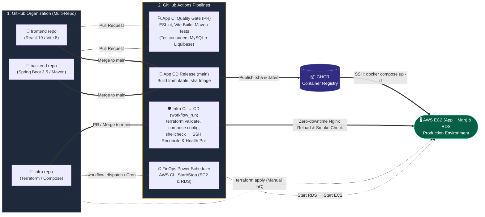

# CI/CD Pipelines, Immutable Deployment & Rollback Runbook

This guide explains how infrastructure configurations and application containers are validated, deployed to AWS EC2 with zero-downtime gateway reloads, verified via container health polling, and rolled back.

---

## 1. Pipeline Orchestration (`workflow_run`)

The repository uses a chained two-stage GitHub Actions workflow under `.github/workflows/` so that unvalidated infrastructure changes can never be deployed to production.



### Stage 1: Infrastructure CI (`.github/workflows/infra-ci.yml`)
Runs on every `pull_request` (`develop`, `main`) and `push` to `main`:
1. **Terraform Validation:** Runs `terraform init -backend=false` and `terraform validate` in `./terraform`.
2. **Compose Syntax Verification:** Copies `.env.example` to `.env` in both `./compose` and `./monitoring` and validates schemas via `docker compose config -q`.
3. **ShellCheck Static Analysis:** Lints all operational scripts via `shellcheck --severity=error scripts/*.sh`.

### Stage 2: Infrastructure CD (`.github/workflows/infra-cd.yml`)
Triggered automatically via `workflow_run` only when **Infrastructure CI** succeeds on `main` (or manually via `workflow_dispatch`):
1. **Primary App EC2 Reconciliation:**
   * Connects over SSH (`ubuntu@$SERVER_IP`) and synchronizes `~/infra` with `origin/main`.
   * Reconciles services via `docker compose up -d --remove-orphans` in `~/infra/compose`.
   * Validates Nginx configuration (`docker exec moviematch_gateway nginx -t`) and performs a zero-downtime reload (`nginx -s reload`).
2. **Real Container Health Polling:**
   * Rather than using arbitrary `sleep` timers, CD polls `docker inspect --format='{{.State.Health.Status}}' moviematch_gateway` every 2 seconds (up to 15 attempts / 30 seconds).
   * If the container does not reach `healthy`, the job outputs `docker logs --tail 50 moviematch_gateway` and fails immediately.
3. **Dynamic Monitoring EC2 Sync:**
   * Queries AWS CLI for a running instance tagged `Name=team262-app-monitoring-ec2`. If the instance is stopped, the step exits cleanly.
   * When running, injects the App EC2 private IP (`10.0.1.171`) into `prometheus.yml` and restarts Prometheus.
4. **External HTTPS Smoke Check:**
   * Executes `curl -fsS --retry 3 --retry-delay 2 https://what2watch.duckdns.org/gateway-health` to verify external TLS and gateway routing.

---

## 2. Immutable `sha-` Image Deployment Model

Both the `frontend` and `backend` repositories build multi-stage Docker images and publish immutable artifacts to GitHub Container Registry (GHCR) tagged with the commit SHA (e.g., `sha-8f4e2a1`).

### Production Rollout Workflow
1. Production environment variables in `/home/ubuntu/infra/compose/.env` reference immutable `sha-` tags for `BACKEND_IMAGE` and `FRONTEND_IMAGE`:
   ```dotenv
   COMPOSE_PROFILES=
   NGINX_CONF_FILE=nginx.conf
   BACKEND_IMAGE=ghcr.io/mate-academy-team-projects/team262-backend:sha-8f4e2a1
   FRONTEND_IMAGE=ghcr.io/mate-academy-team-projects/team262-frontend:sha-3c9d1b4
   ```
2. When an application pipeline deploys a new release, it updates the corresponding image tag in `~/infra/compose/.env`, pulls the image, and recreates the service:
   ```bash
   cd ~/infra/compose
   docker compose pull backend
   docker compose up -d --no-deps backend
   ```
3. Docker Compose healthchecks continuously verify container readiness:
   * **Backend:** `wget -q -O /dev/null http://127.0.0.1:8080/actuator/health || wget -q -O /dev/null http://127.0.0.1:8080/v3/api-docs` (`start_period: 40s`, `interval: 15s`, `retries: 3`).
   * **Frontend:** `wget -q -O /dev/null http://127.0.0.1:80/` (`interval: 15s`, `retries: 3`).
   * **Gateway:** `wget -q -O /dev/null http://127.0.0.1/gateway-health` (`interval: 10s`, `retries: 3`).

---

## 3. 30-Second Emergency Rollback Runbook

Because previous `sha-` images remain cached on the App EC2 host and in GHCR, rolling back a faulty release takes less than 30 seconds.

### Step-by-Step Rollback Procedure

1. **Connect to the Primary App EC2 Host:**
   ```bash
   ssh -i ~/.ssh/id_ed25519 ubuntu@<APP_EC2_PUBLIC_IP>
   cd ~/infra/compose
   ```

2. **Inspect Cached `sha-` Images to Select the Last Known-Good Release:**
   ```bash
   docker images --format "table {{.Repository}}\t{{.Tag}}\t{{.CreatedSince}}" | grep -E "backend|frontend"
   ```

3. **Pin the Previous `sha-` Tag in `.env`:**
   ```bash
   # Replace <PREVIOUS_SHA_TAG> with the target sha-<commit> tag
   sed -i 's|^BACKEND_IMAGE=.*|BACKEND_IMAGE=ghcr.io/mate-academy-team-projects/team262-backend:sha-<PREVIOUS_SHA_TAG>|' .env
   ```

4. **Recreate the Service & Reload Gateway DNS:**
   ```bash
   docker compose up -d --no-deps backend
   docker exec moviematch_gateway nginx -s reload
   ```
   > **Why reload Nginx?** Nginx resolves `http://backend:8080` and `http://frontend:80` via Docker's internal DNS on startup. Reloading Nginx after container recreation refreshes upstream IP bindings and prevents `502 Bad Gateway` responses.

5. **Confirm Recovery:**
   ```bash
   docker ps --format "table {{.Names}}\t{{.Image}}\t{{.Status}}"
   curl -fsS https://what2watch.duckdns.org/gateway-health
   ```